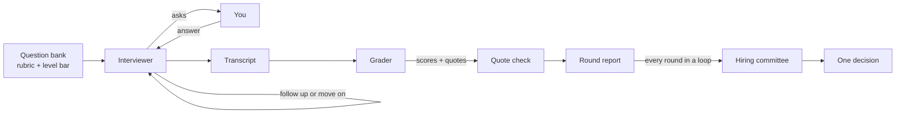

# onsite

An AI mock interviewer that runs a real onsite loop and grades you like a hiring committee.

Most AI interview tools ask a question, wait for your answer, and give you a generous score. Real interviews
don't work like that. A real interviewer digs into the weak parts of your answer, and a real hiring committee
only gives credit for what you actually said.

onsite does both.

## What makes it different

- **It follows up like a real interviewer.** After every answer it checks which rubric items it still has no
  evidence for, and asks about those. Said "we" the whole time? It asks what *you* did. No result? It asks
  how it ended and how you measured it.
- **It stays neutral.** No "great answer!" in the middle of the round. You find out how you did at the end,
  the same as in a real loop.
- **Every score needs proof.** The grader must quote your exact words for each score. The code then checks
  each quote against the transcript. If the quote isn't really there, the score drops to 1. No evidence, no
  credit.
- **Graded for your level.** The bar for a junior is not the bar for a staff engineer. Each round is scored
  against the level you pick.
- **Practise in the browser.** `onsite web` opens a page with the interviewer on one side and a code editor
  or a whiteboard on the other, like a real onsite. Your code or diagram goes to the interviewer with your
  next answer whenever it changes.
- **You can talk instead of type.** With `--voice` the interviewer speaks and you answer out loud, like a
  real call. Speech runs on your machine, so your voice never leaves it.
- **Hiring committee style result.** Scores on a 1 to 4 scale per rubric item, then a decision from Strong No
  Hire to Strong Hire. One clear red flag blocks a hire, like it would in a real committee.
- **It reads your resume.** Pass `--resume` and the interviewer asks about your real projects, the way a
  real one would after reading it. Every question must point at a line that's really on your resume, or it's
  thrown away.
- **It tracks your progress.** `onsite progress` reads every report you've saved and shows which rubric
  items are improving, which aren't, and what to practise next.
- **A full onsite loop.** Run coding, system design and behavioral rounds back to back, each with its own
  interviewer. Then a hiring committee reads every round's feedback and makes one decision. It looks for
  patterns across rounds, can offer you the level below, and tells you the three things to practise next.

## Rounds

| Track | What it covers |
| --- | --- |
| `behavioral` | Structure, ownership, judgment, impact, reflection |
| `coding` | Problem understanding, approach, correctness, complexity, communication |
| `system_design` | Requirements, high-level design, deep dive, trade-offs, communication |

The bank has 43 questions: 15 behavioral, 16 coding and 12 system design. Each one is tagged with the levels
it suits, so a junior isn't asked to design a distributed key-value store and a staff engineer isn't asked
two sum. Each question comes with what a strong answer covers and the follow-ups a real interviewer would use.
Run `onsite questions` to see them, or browse [`src/onsite/bank`](src/onsite/bank).

## Quick start

You need [uv](https://docs.astral.sh/uv/) and an Anthropic API key.

```bash
git clone https://github.com/habul17/onsite.git
cd onsite
uv sync
export ANTHROPIC_API_KEY=your-key
uv run onsite start --track behavioral --level senior
```

During the round:

- Press Enter on an empty line to send your answer.
- Wrap code in ``` so blank lines inside it are kept.
- Type `/skip` to skip a question, or `/quit` to stop and get graded on what you answered.

At the end you get a score table in the terminal and a full report in `reports/`, with the evidence for every
score and the whole transcript.

### Full loop

Run a whole onsite, round after round:

```bash
uv run onsite loop --level senior
```

- The default loop is coding, then system design, then behavioral. You get a break between rounds.
- You see no scores until the end, like a real loop.
- Build your own loop with `--round`, for example `--round coding --round coding --round behavioral`. Two
  rounds of the same kind never get the same question.
- Type `/quit` at any time to stop. Everything you answered still gets graded, and the committee notes that
  the loop was cut short.

How the committee decides:

- Every round counts the same. The average sets the decision.
- One interviewer saying No Hire blocks a hire, even when the average is high.
- The decision comes from these fixed rules, not from the model. The model writes the reasoning: patterns
  across rounds, the strongest signal, the biggest concern and what to practise.
- A pattern must show up in at least two rounds to be reported. The code checks that.
- If you miss the bar for your level, the committee can say you'd be hired one level down, like real
  committees do.

Everything is saved in one folder in `reports/`: the committee write-up and each round's full report.

### In the browser

```bash
uv sync --extra web
uv run onsite web
```

- Pick a round and a level, and the page opens the round. Enter sends your answer, Shift+Enter starts a new
  line.
- Coding rounds put a code editor beside the chat, with line numbers, Tab to indent and auto-indent on Enter.
  Ctrl+Enter sends from the editor. Your code is sent with your next answer, but only when it has changed.
- Design rounds put a whiteboard beside the chat. Add clients, services, databases, caches, queues, storage
  and notes, then join them with labelled arrows: drag from a box's dot, or use the Connect row. Everything
  also works from the keyboard.
- The interviewer reads the whiteboard as text, a list of components and the arrows between them, so it can
  ask about a missing cache or a single point of failure. The grader can quote it like anything you said.
  Moving boxes around doesn't count as a change.
- Coding and design rounds keep the question pinned above the chat while you work.
- The report shows the decision, every score, and why each score was given, with the quotes behind it. It's
  saved to `reports/` like any other round, so `onsite progress` counts it.
- It runs only on your machine. The server listens on 127.0.0.1 and refuses requests addressed to any other
  host name, so another website can't use it to spend your API key.

### Progress over time

```bash
uv run onsite progress
uv run onsite progress --track coding --level senior
```

- Rounds are grouped by kind and level. A 3 at senior isn't the same as a 3 at junior, so they're never mixed.
- For each rubric item you see your earlier score, your recent score, the change, and a small chart of every
  round. It compares your first few rounds with your last few, so one bad day doesn't swing the trend.
- Rounds from a full loop count too, and so does the loop's final decision.
- When you've met the bar in each of your last 3 rounds of a kind, it tells you you're ready.
- It ends with the 3 rubric items furthest below the bar, so you know what to work on next.

### Questions from your resume

```bash
uv run onsite start --track behavioral --level senior --resume resume.pdf
uv run onsite loop --level senior --resume resume.pdf
```

- Behavioral questions dig into the projects and claims on your resume: "You led the ledger migration. What
  was the hardest call you made?"
- Design questions ask you to design something close to what you've built, at full scale.
- Coding rounds still use the question bank. Your resume doesn't change what a fair coding problem is.
- Every question comes with the resume line it's about. The code checks that line is really on your resume,
  and drops the question if it isn't, so the interviewer can't ask about work you never did. If it can't find
  enough, the rest come from the question bank.
- The report shows the resume line behind each question.

PDF, Markdown and plain text files all work. Your resume's text is sent to the model along with the round.

### Voice mode

Hear the interviewer and answer out loud:

```bash
uv sync --extra voice
uv run onsite voice-check                       # test your speakers and mic first
uv run onsite start --track behavioral --voice
```

- Press Enter to start talking, and Enter again when you're done.
- You see what it heard before it's sent. Press Enter to send, or type `r` to record again.
- You can still type any answer, which helps when you need to write code.

Everything runs locally: [Kokoro](https://huggingface.co/hexgrad/Kokoro-82M) for the interviewer's voice and
[Whisper](https://github.com/SYSTRAN/faster-whisper) for your answers. Only the text goes to the model. The
first run downloads about 270 MB of models. No system packages are needed.

Whisper is primed with the question you're answering and common tech terms, so words like Postgres, Kafka
and O(n log n) come out right.

### Options

```bash
uv run onsite start --track coding --level mid          # one coding problem
uv run onsite start --track system_design --level staff # one design question
uv run onsite start --questions 4 --follow-ups 2        # more questions, fewer follow-ups
uv run onsite start --seed 42                           # same questions every time
uv run onsite start --voice                             # talk instead of type
uv run onsite loop --level staff --voice                # a full loop, out loud
uv run onsite start --resume resume.pdf                 # questions about your own work
uv run onsite progress                                  # how you're doing over time
uv run onsite web --port 8080                           # practise in the browser
uv run onsite questions --track coding --level senior   # the coding problems asked at senior
```

| Variable | What it does | Default |
| --- | --- | --- |
| `ONSITE_MODEL` | Model for the interviewer and grader | set in `llm.py` |
| `ONSITE_VOICE` | Interviewer voice, for example `am_michael` or `bf_emma` | `af_heart` |
| `ONSITE_WHISPER_MODEL` | Speech to text model. `small.en` is more accurate but slower | `base.en` |

## How it works



1. **Interviewer** (`interviewer.py`). For each answer, the model decides to follow up or move on and writes a
   private note on what evidence is still missing. The code enforces the follow-up limit, so a round never
   drags on.
2. **Grader** (`grader.py`). After the round, each question is graded on its own. The schema has one required
   field per rubric item, so nothing can be skipped. Each score comes with evidence quotes, reasoning, and
   then the score, in that order.
3. **Quote check** (`grader.py`). Every quote is matched against what you actually said (not the
   interviewer), with a small tolerance for punctuation. Scores without a real quote are set to 1.
4. **Decision** (`grader.py`). The final decision is computed from the averages with fixed rules, so the same
   scores always give the same result.
5. **Committee** (`committee.py`). In a full loop, every round's decision feeds one more set of fixed rules.
   The model only writes the notes, and any pattern it claims must name two rounds that really happened.
6. **Resume questions** (`resume.py`). With `--resume`, the model writes questions about your resume before
   the round starts, each with the exact line it's about. The code drops any question whose line isn't on the
   resume, and any second question about the same line.
7. **Progress** (`history.py`). Reads every saved report. Trends and the "work on next" list are plain maths
   on your scores, so there's no model call and nothing leaves your machine.
8. **Web app** (`web/`). The same interviewer and grader behind a small local API, and a page with no build
   step. A second click while the interviewer is thinking is refused, so an answer is never sent twice.
9. **Whiteboard** (`whiteboard.py`). The diagram is written out as text, components then arrows, and added to
   your answer only when that text changes. Arrows to boxes that aren't there are dropped, and every box gets
   a unique name so the transcript is never ambiguous.

## Development

```bash
uv run pytest
```

The tests use a fake model, so they run offline and cost nothing. Run `uv sync --extra voice --extra web`
first to include the audio and web app tests. They don't need a microphone, speakers or a browser.

## Roadmap

- [x] Voice mode: speak your answers and hear the interviewer
- [x] Web app with a code editor for coding rounds
- [x] Whiteboard in the web app for design rounds
- [x] Questions based on your resume
- [x] Full onsite loop: several rounds and one combined hiring decision
- [x] Progress over time across your saved reports
- [x] Bigger question bank, with questions tagged by level

## License

MIT
